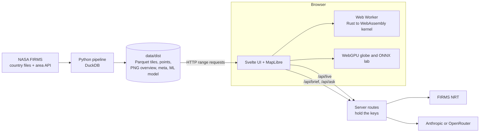

# Harmony

**Two satellites. One fire record.**

Harmony joins two generations of fire-detecting satellites, MODIS (2000, ending) and VIIRS (2012, running on), into one consistent monthly record of burning activity for any area on Earth. It exists because the two instruments report very different numbers of hotspots for the same fires, so a raw count series from 2000 to today has a break in it. It is for anyone who needs to say when an area burns, which years were extreme and how this month compares with normal: duty officers, land managers, journalists and fire scientists.

Built by [Toh Yu Heng](https://hello.hernie.me), Singapore, for NASA Space Apps 2026, challenge **Harmonization of MODIS and VIIRS Hot Spots**. Data: NASA FIRMS only.

Documents: [method](docs/METHOD.md) · [architecture](docs/ARCHITECTURE.md) · [operations](docs/OPERATIONS.md) · [data contract](schema/data-contract.md) · [validation schema](schema/validation.md) · [ML schema](schema/ml.md)

## What you can do

The first six items are what the challenge asks for. The rest go beyond it.

| Challenge ask | In Harmony |
| --- | --- |
| Select an area interactively, by drawing or by latitude and longitude | Draw a polygon, rectangle or circle on the map (terra-draw); type a centre and radius, or a bounding box; load or drop a GeoJSON polygon; or pick one of six story presets. The view is stored in the URL hash, so a link reproduces it. |
| Burning calendar with accessible colour ramps | A year-by-month grid for the area. Three modes: activity, anomaly (ratio to the median of the same month) and percentile. Inferno for activity and a blue-to-orange diverging ramp for anomalies, both colour-blind safe, with the value printed in each cell, keyboard navigation, and light and dark themes. |
| Anomalies against the multi-year median | Baseline years are adjustable (default 2003-2022). Median, percentile, rank and a robust z-score per calendar month. |
| Number of fires detected | Raw detection counts for MODIS and VIIRS next to the harmonized series, for the same area. |
| Downloadable hotspot CSV | Polygon-exact export of the individual detections for the area and a date range, read in the browser from a Parquet archive. Columns include sensor, confidence, FRP and a flag for whether the detection entered the harmonized record. Calendar CSV, full series CSV, calendar PNG and SVG, and AOI GeoJSON are also offered. |
| Current month against the historical median | The status strip and the "current" card give the ratio, percentile and rank for the latest month, and year-to-date against the envelope of past years. |

| Beyond the ask | What it is |
| --- | --- |
| The seam | A chart of the raw VIIRS-to-MODIS ratio against the harmonized ratio, and a switch that moves the year where the series changes from MODIS to calibrated VIIRS (default 2023). The 2012 and 2018 jumps are visible in the raw series and absent in the harmonized one. |
| Uncertainty | 80 % and 95 % bands on every month served from VIIRS or the Terra bridge. |
| Live now-versus-normal | Near-real-time detections for the area over the last 24 hours, 48 hours or 7 days, and a daily pace in the record's own unit against the normal pace for the month. Needs a FIRMS key on the server. |
| Global pulse | A WebGPU globe (canvas fallback) that animates the harmonized global record month by month, with an anomaly mode against the climatology. |
| Outlook | One to three months ahead from the seasonal cycle and decaying persistence of the anomaly, with a leave-one-year-out skill measure. When it does not beat climatology the app shows climatology. |
| Brief and Ask Harmony | A plain-language reading of the statistics for the area, written by Claude from the computed numbers only (a rule-based brief is used without a key), and follow-up questions on the same numbers. Figures in the text are checked against the statistics. |
| Method lab | A small neural network trained as an independent calibration, run on WebGPU in the browser for the selected area and compared with the production ratio method and with observed MODIS. |

## How the harmonization works

1. **Filter.** MODIS confidence of 30 or more; VIIRS confidence nominal or high; FIRMS `type` 0 (vegetation fire) where `type` exists; and Harmony's own static-heat-source mask, applied to every row including near-real-time rows, which carry no `type`.
2. **Common unit.** The unit is the *MODIS-equivalent active-fire cell-day* (AFCD-M): one distinct 0.0125° sub-cell, local-solar date and day or night with at least one accepted detection. Counting cell-days instead of detections collapses VIIRS's many 375 m pixels per fire towards what MODIS's 1 km pixel reports. Monthly sums are served on a 0.05° grid.
3. **Coverage.** Satellite outages and partial months are detected from the daily counts and corrected, and VIIRS is the per-day mean over the satellites operating, never the sum.
4. **Strata.** RESOLVE Ecoregions 2017 biome by realm (64 strata incl. "unclassified").
5. **Calibration.** A multiplicative ratio per stratum, day or night and month of the year, fitted on 2012-02 to 2021-12 (both sensors, before MODIS orbit drift), with a per-cell shrinkage multiplier. A Terra-only bridge extends MODIS back to 2000-11. Coefficients are applied unchanged to later months.
6. **Final series.** Scaled Terra, then native MODIS (to 2022-12), then calibrated VIIRS (from 2023-01 by default; adjustable in the interface). Each month carries its source, a provisional flag and an uncertainty band.

Full details, equations and limits: [docs/METHOD.md](docs/METHOD.md).

### Headline validation (as of the 2026-11-15 build)

Source: `data/dist/validation.json`. All figures are from the full global build. A refresh with complete 2026 data will change them; update this table from the same file.

| Check | Naive (raw counts or one global ratio) | Harmonized |
| --- | --- | --- |
| VIIRS-to-MODIS ratio by year, 2013-2025 | Raw detection count ratio 3.9-4.1 (2013-2017), 7.1 (2018), 8.0-8.8 (2019-2025) | Calibrated VIIRS to MODIS-equivalent: 0.98 to 1.07 |
| Leave-one-year-out 2012-2021, stratum-month, correlation of log(1+x) | 0.981 | 0.988 |
| Same, log-RMSE | 0.611 | 0.459 |
| Leave-one-year-out, 1-degree cell-month, correlation | 0.928 | 0.944 |
| Same, log-RMSE | 0.681 | 0.601 |
| Out-of-time bias against still-observed MODIS, 2022 / 2023 / 2024 / 2025 | not computed | +1.2 % / +1.5 % / 0.0 % / +7.3 % |
| Change-point test at the 2023-01 switch (Pettitt, 2020-2025 window) | p < 0.0001, step 2.19 in log units (a factor of 8.9) | p = 0.18, step 0.065 (a factor of 1.07) |
| Change-point test at VIIRS start (2012-02) | p < 0.0001, step 1.37 | p = 0.14, step -0.069 |
| Interval coverage, leave-one-year-out, 1-degree cell-months with H of 5 or more | n/a | 80 % interval: 0.80 (tuned); 95 % interval: 0.91 |

Two results that do not favour the method are in [docs/METHOD.md](docs/METHOD.md): the naive ratio agrees slightly better on the sign of anomalies at stratum scale (0.899 against 0.893), and 2025 is 7 % high against MODIS.

## NASA data used

All fire data are official NASA FIRMS products. Nothing is taken from another fire source.

| Product | Satellite | Years | Access path | Rows in the 2026-11-15 build |
| --- | --- | --- | --- | --- |
| MODIS Collection 6.1 active fire (MCD14ML), standard quality | Terra, Aqua | 2000-2025 bulk; 2026 via API (standard to 2026-08-31, near-real-time after) | FIRMS country-year files, then FIRMS area API | 114,530,845 |
| VIIRS 375 m active fire (VNP14IMGTDL), standard quality | Suomi NPP | 2012-2025 bulk; 2026 via API until delivery stopped on 2026-11-02 | same | 281,144,355 (bulk years only) |
| VIIRS 375 m active fire (VJ114IMGTDL), standard quality | NOAA-20 | 2018-2025 bulk; 2026 via API | same | 155,932,197 (bulk years only) |
| VIIRS 375 m active fire, standard quality | NOAA-21 | from 2023-03 via API (no bulk files) | FIRMS area API | 3,161,650 (2023-03 to 2023-05 only) |

Row counts are normalized rows after removing exact duplicates and near-real-time rows superseded by standard ones, summed from `data/work/normalize_stats/`. In this build the 2026 VIIRS months and NOAA-21 after 2023-05 are not yet ingested; the refresh will add them. Of the 554,769,047 normalized rows, 103,788,286 MODIS and 351,192,421 VIIRS detections were accepted by the filters (`data/dist/tiles/L2`, column sums).

Reference data that is not fire data: RESOLVE Ecoregions 2017 (strata and land mask). The strata step downloads it from its public host.

> We acknowledge the use of data and/or imagery from NASA's Fire Information for Resource Management System (FIRMS) (https://earthdata.nasa.gov/firms), part of NASA's Earth Observing System Data and Information System (EOSDIS).

The app repeats this text in its footer and About panel and in every export. Harmony is not endorsed by NASA.

## Architecture



An offline Python pipeline turns the FIRMS files into a static pyramid of Parquet tiles at 0.05°, 0.25° and 1°. The browser reads only the tiles that touch the drawn area, picks the finest level that fits a 16 MiB budget, and a Rust kernel compiled to WebAssembly does all the analysis in a Web Worker. Three small server routes exist only because they need secrets: the FIRMS near-real-time proxy and the two AI routes. Everything else is static files, so it can be hosted on any server that supports HTTP range requests. See [docs/ARCHITECTURE.md](docs/ARCHITECTURE.md).

## Repository layout

| Path | Content |
| --- | --- |
| `pipeline/` | Python 3.13 pipeline (uv, DuckDB): one module per stage, parameters in `config.py` |
| `crates/harmony-core/`, `crates/harmony-wasm/` | Rust analysis kernel and its WebAssembly wrapper |
| `web/` | Vite, Svelte 5 and TypeScript app; `web/server/` holds the three server routes |
| `schema/` | The interfaces between the parts: data contract, validation and ML schemas |
| `scripts/` | WASM build script and the smoke tests |
| `docs/` | Method, architecture, operations, brand notes, original design |

## Quick start

`data/` is not in git. The app needs the pipeline output at `data/dist/`; without it the app starts in a labelled demo mode on synthetic numbers. Build the data (next section) or copy a finished `data/dist/` into place. The tile pyramid is about 0.5 GB; the hotspot archive for CSV export is about 10 GB and is optional (the export reports itself unavailable without it).

Prerequisites:

- Node 24 or newer and pnpm.
- Rust (stable) with the `wasm32-unknown-unknown` target, and `wasm-bindgen-cli` 0.2.130 (the version is pinned in `crates/harmony-wasm/Cargo.toml`).
- [uv](https://docs.astral.sh/uv/) (it installs Python 3.13 for the pipeline).
- A free FIRMS map key from https://firms.modaps.eosdis.nasa.gov/api/map_key/ (needed for the API top-up and the live view).
- Optional: an Anthropic API key for the brief and Ask Harmony. Without one the app uses the rule-based brief and hides Ask.

```bash
cp .env.example .env.local        # fill FIRMS_MAP_KEY, optionally ANTHROPIC_API_KEY; .env.local is git-ignored
bash scripts/build-wasm.sh        # builds the Rust kernel to web/src/lib/kernel/pkg/ (git-ignored)
pnpm --dir web install
pnpm --dir web dev                # http://localhost:5173, serves data/dist at /data and the /api routes
```

Without the WASM build the app falls back to the demo mode as well. For a production build, `pnpm --dir web build` then `pnpm --dir web preview` (the preview server also serves `/data` and the `/api` routes).

## Rebuilding the data

From `pipeline/`. Stage details and the top-up routine are in [docs/OPERATIONS.md](docs/OPERATIONS.md).

```bash
cd pipeline
uv run python -m harmony_pipeline.cli fetch-country   # FIRMS country-year zips (about 9 GB)
uv run python -m harmony_pipeline.cli fetch-api       # 2026 and NOAA-21 from the area API (needs FIRMS_MAP_KEY)
uv run python -m harmony_pipeline.cli all             # normalize, availability, static_mask, afcd, strata, calibrate, tiles, points, overview, verify
uv run python -m harmony_pipeline.cli ml              # optional: ML challenger (not part of `all`)
```

Measured on the 2026-11-15 global build (12-thread machine, DuckDB limited to 12 GB): normalize about 82 min, static mask 2 min, cube 13 min, strata 4 min, calibration 2 min, tiles 7 min, points archive 45 min or more, ML 3.5 min; about 2.5 to 3 hours in total after the downloads. Disk used: about 16 GB of raw downloads, 12 GB of normalized points, and 8 to 10 GB of output. Plan for 50 GB free.

## Tests and checks

| Command | What it checks | Needs |
| --- | --- | --- |
| `cargo test --workspace` | 28 kernel tests: polygon coverage against brute force, zonal sums, the interval formula against a hand computation, statistics, outlook, and timing guards | Rust |
| `bash scripts/build-wasm.sh && node scripts/kernel-smoke.mjs` | The built WASM kernel on a synthetic tile: output shapes and values, and timings | built kernel |
| `node scripts/live-smoke.mjs --unit` | Live proxy: validation, snapping, cache, in-flight de-duplication, usage guard, key redaction; and the pace computation | Node 24 |
| `node scripts/brief-smoke.mjs --offline` | AI routes against mock Anthropic and OpenRouter servers: request shapes, retry, fallback, output validation, rate limits | Node 24 |
| `node scripts/hotspots-export-test.mjs` | The CSV export code against real point files over local HTTP, cross-checked against DuckDB | `data/dist/points`, uv env |
| `uv run python -m harmony_pipeline.cli verify` (inside `all`) | Raw-to-normalized row reconciliation, no SP/NRT overlap, tile totals equal accepted detections, additive levels, points archive rows, official country CSV row counts, top anomaly months per realm | pipeline data |
| `pnpm --dir web check` | Svelte and TypeScript type check | `pnpm install` |

The `live-smoke --url` and `brief-smoke --url` modes make real FIRMS and model calls against a running dev server (a few small requests; fractions of a cent).

The `verify` report on disk (`data/work/verify.json`) was written for an earlier five-country regional run and passed; it has not yet been written for the global build. Run the stage on the refreshed data before quoting it.

## Limitations

- **Detections are not burned area.** AFCD-M measures how often a place is seen burning, not how much burned, how intense it was or what was lost.
- **Sampling.** Cloud, smoke, dense canopy and overpass times hide fires, and the unit does not correct for them. Terra and Aqua have drifted from their original equator-crossing times since about 2021, which changes the time of day they sample; part of the out-of-time bias in 2025 is probably this.
- **Provisional months.** Months built from near-real-time data are flagged. In the live view, near-real-time rows are not screened for gas flares and industrial sources, because the static mask is applied in the pipeline, not to the live rows.
- **Live pace is approximate.** It uses NOAA-20 and NOAA-21 only, treats a satellite with no rows on a day as not reporting when the other has at least 20, scales with the area's own calendar-month ratio between calibrated and raw VIIRS, and compares with the median of the same month spread evenly over its days.
- **Continental areas.** If even the 1° level exceeds the 16 MiB budget the app still loads the 1° level and does not refuse; very large areas are slow to load and are shown at 1° resolution.
- **Areas crossing the antimeridian** are not supported in the interface or in the live route.
- **Uncertainty.** The interval is tuned to cover leave-one-year-out 1° cell-months; the raw model interval covered only 48 % of them (a scale factor of 2.24 is applied). Coverage for large areas, and for cells with 100 or more cell-days a month (0.73 at 80 %), is lower. The 95 % interval covers 91 %.
- **Weakest strata.** Tundra and boreal strata have the largest stratum-month errors; cells outside any ecoregion are poorly calibrated.
- **No cropland stratum** yet (planned, not built).
- **Build gaps.** The build of 2026-11-15 does not yet contain 2026 VIIRS data or NOAA-21 after 2023-05, so 2026 months are served from MODIS, and the Global pulse shows no activity after 2026-01.
- **Ending sensors.** S-NPP delivered its last data on 2026-11-02 and MODIS is expected to end around 2027. The record then rests on NOAA-20 and NOAA-21.

## AI in the application

The situation brief and Ask Harmony call Claude models (Sonnet 5.5 by default, Opus 5.5 as an option) through the Anthropic API or, optionally, OpenRouter. The model receives only the statistics computed for the selected area, and the figures in its answer are checked against them. Without a key the app shows a rule-based brief instead.

## Credits

Harmony is by [Toh Yu Heng](https://hello.hernie.me), Singapore, made for NASA Space Apps 2026, challenge "Harmonization of MODIS and VIIRS Hot Spots".

| Component | Use | Licence |
| --- | --- | --- |
| NASA FIRMS (MODIS, VIIRS) | All fire data | NASA open data; acknowledgement above |
| RESOLVE Ecoregions 2017 (Dinerstein et al.) | Strata, land mask | CC-BY 4.0 |
| OpenFreeMap, OpenMapTiles, OpenStreetMap contributors | Basemap | Attribution shown in the app |
| MapLibre GL JS 6 | Map | BSD-3-Clause |
| terra-draw and its MapLibre adapter | Drawing | MIT |
| hyparquet, hyparquet-compressors | Parquet reading in the browser | MIT |
| Observable Plot, d3-scale-chromatic | Charts, colour ramps | ISC |
| onnxruntime-web | ML challenger | MIT |
| Svelte 5, Vite 8, sirv | Application framework and build | MIT |
| @anthropic-ai/sdk | AI routes | Apache-2.0 |
| Barlow, JetBrains Mono, Schibsted Grotesk (via Fontsource) | Typefaces | OFL-1.1 |
| DuckDB (with its spatial extension), NumPy, pandas, shapely, onnx, onnxruntime | Pipeline | MIT / BSD / Apache-2.0 |
| serde, wasm-bindgen | Rust kernel | MIT or Apache-2.0 |

Licences were read from the installed packages for the web dependencies; check the upstream licence for any redistribution.

© 2026 Harmony, by Toh Yu Heng. All rights reserved.

The licence for this repository is the author's decision and has not been set here.
