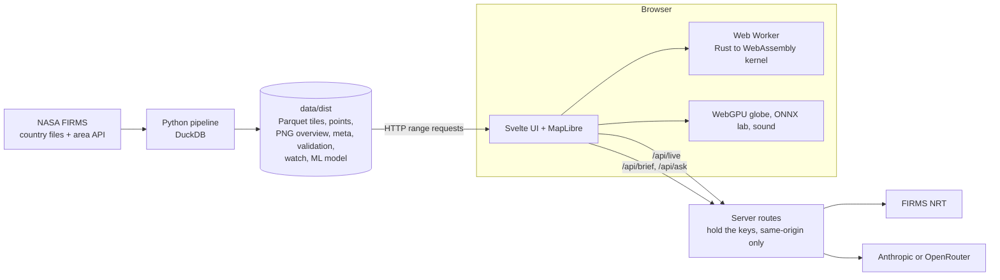

# Harmony

**Two satellites. One fire record.**

**Live app: <https://harmony.hernie.me>** · Slides: <https://harmony.hernie.me/demo> · Deployment: [docs/DEPLOYMENT.md](docs/DEPLOYMENT.md)

Harmony joins two generations of fire-detecting satellites, MODIS (2000, ending) and VIIRS (2012, running on), into one consistent monthly record of burning activity for any area on Earth. It exists because the two instruments report very different numbers of hotspots for the same fires, so a raw count series from 2000 to today has a break in it, and because MODIS Terra and Aqua have drifted away from their original overpass times since about 2021. It is for anyone who needs to say when an area burns, which years were extreme and how this month compares with normal: duty officers, land managers, journalists and fire scientists.

Built by [Toh Yu Heng](https://hello.hernie.me), Singapore, for NASA Space Apps 2026, challenge **Harmonization of MODIS and VIIRS Hot Spots**. Data: NASA FIRMS only.

Documents: [method](docs/METHOD.md) · [architecture](docs/ARCHITECTURE.md) · [operations](docs/OPERATIONS.md) · [data contract](schema/data-contract.md) · [validation schema](schema/validation.md) · [ML schema](schema/ml.md) · [watchlist schema](schema/watch.md) · [deck sources](docs/deck/README.md) · [Space Apps submission](docs/SUBMISSION.md)

## Results that matter

All figures are from the 2026-11-15 global build and are read from `data/dist/validation.json` (tables and caveats in [docs/METHOD.md](docs/METHOD.md), Tables M1 to M11). The record uses 658,009,224 FIRMS detections (2000-11 to 2026-11-15); 535,642,631 of them pass the filters (535,670,069 before the review rebuild of the same day removed 27,438 near-real-time detections over water and on burst days).

| Question | Result |
| --- | --- |
| Is the seam gone? | The VIIRS-to-MODIS ratio of raw detection counts is 3.8 to 4.1 in 2012-2017, 7.1 in 2018 (NOAA-20 joins), 8.1 to 8.3 in 2019-2022 and 11.6 to 12.9 in 2023-2025 (NOAA-21 joins). After calibration the same ratio is 0.98 to 1.03 in 2013-2024. A Pettitt change-point test at the 2023-01 switch finds a step of +2.53 in log units (a factor of 12.6, p < 0.0001) in raw counts and none in the harmonized series (p = 0.15; the detected change month is 2025-02, step -0.12). At the start of VIIRS (2012-02): raw +1.37 (p < 0.0001), harmonized p = 0.14. On the fused record the same tests give p = 0.11 at the start of VIIRS and p = 0.059 in the window around the 2023-01 switch (Table M4b). |
| How far have Terra and Aqua drifted? | Measured against VIIRS, which keeps its overpass. By 2025 Terra detects 58 % of the expected number by day (95 % interval 53 to 63 %) and 135 % at night; Aqua at night detects 83 %; Terra and Aqua combined detect 90 % by day and 120 % at night. The mean local overpass time of Terra detections had moved 1.1 hours earlier and Aqua's 1.1 hours later. In the placebo years 2012-2019 the combined ratio varies by 1.4 % (day) and 2.5 % (night), RMS. This is the change in MODIS relative to VIIRS; it cannot tell a moving overpass from a real change in when fires burn. |
| How accurate is the VIIRS-to-MODIS calibration on years it has not seen? | Leave-one-year-out, 2012-2021, against observed MODIS: at stratum-month scale r = 0.988 and log-RMSE 0.458 (one global ratio: r = 0.981, log-RMSE 0.607); at 1-degree cell-month scale r = 0.944 and log-RMSE 0.600 (one global ratio: 0.928 and 0.680). NOAA-21, which enters no fit, is within +0.5 % (2023) and +0.3 % (2024) of observed MODIS and within 0.6 % of drift-corrected MODIS in 2023-2025. |
| Do the uncertainty bands cover? | Intervals are split-conformal, calibrated per biome group and activity size. Held out in time (frozen calibration, 2022-2024, against observed MODIS) and pooled over the three supports (1-degree cells, 5-degree blocks, strata), the nominal 80 % and 95 % intervals cover 0.76 and 0.93 of unit-months with 5 or more cell-days, and 0.79 and 0.94 of all unit-months. They fall a few points short of nominal out of sample; by size class the 80 % coverage is 0.71 to 0.80. |

Two results that do not favour the method. Precision-weighted fusion of MODIS and VIIRS is the default record, but against an independent reference (Terra) a plain equal-weight mean does about as well (1-degree log-RMSE 0.888 for equal weights, 0.898 for the fusion; Aqua alone 0.949, VIIRS alone 0.932): the gain of fusion over a plain average is not demonstrated. And one global ratio agrees slightly better than the stratified model on the sign of anomalies at stratum scale (0.898 against 0.892).

## Run it

The app needs the pipeline output in `data/dist/`; `data/` is not in git. Without it the app starts in a labelled demo mode on synthetic numbers.

```bash
cp .env.example .env.local        # optional keys: FIRMS_MAP_KEY, ANTHROPIC_API_KEY; .env.local is git-ignored
pnpm --dir web install
pnpm --dir web dev                # http://localhost:5173, serves data/dist at /data and the /api routes
```

No Rust is needed to run the web app: the built WASM kernel is committed in `web/src/lib/kernel/pkg/`. Rebuild it with `bash scripts/build-wasm.sh` only after changing `crates/`; `node scripts/check-wasm.mjs` fails when the committed kernel was built from different Rust sources.

Prerequisites and how to build the data are in [Setup](#setup) and [Rebuilding the data](#rebuilding-the-data). Hosting (Vercel for the app and its `/api` functions, Cloudflare R2 for the data) is described in [docs/DEPLOYMENT.md](docs/DEPLOYMENT.md).

## What you can do

The first six items are what the challenge asks for. The rest go beyond it. The analysis is one guided scroll whose sections are questions (When does it burn? Is this year unusual? Is it getting worse? What is next? What is burning right now? In plain words; How we know; Take it with you), with a sticky section index and in-place explanations of technical terms (a glossary of 27 entries).

| Challenge ask | In Harmony |
| --- | --- |
| Select an area interactively, by drawing or by latitude and longitude | Draw a polygon, rectangle or circle on the map (terra-draw); type a centre and radius, or a bounding box; load or drop a GeoJSON polygon; or pick one of six story presets. The view is stored in the URL hash, so a link reproduces it. |
| Burning calendar with accessible colour ramps | A year-by-month grid for the area in four modes: activity, compared with normal (ratio to the median of the same month), rank among years, and activity with confidence (a dot pattern that gets denser as the interval widens, so confidence is never carried by colour alone). Inferno for activity and a blue-to-orange diverging ramp for anomalies, both colour-blind safe, with the value printed in each cell, keyboard navigation, a table view, and light and dark themes. |
| Anomalies against the multi-year median | Baseline years are adjustable (default 2003-2022). Median, percentile, rank and a robust z-score per calendar month. Statistics use only months with at least half their days covered; a partial latest month is drawn but never enters a statistic. |
| Number of fires detected | Raw detection counts for MODIS and VIIRS next to the harmonized series, for the same area. |
| Downloadable hotspot CSV | Polygon-exact export of the individual detections for the area, read in the browser from a Parquet archive, for the selected month, the selected year or the full displayed range. Columns include sensor, confidence, FRP and a flag for whether the detection entered the harmonized record. Calendar CSV, full series CSV, calendar PNG and SVG, and AOI GeoJSON are also offered. |
| Current month against the historical median | The status strip gives the ratio, percentile and rank for the latest complete month; "Is this year unusual?" gives year to date against the envelope of past years. |

| Beyond the ask | What it is |
| --- | --- |
| The seam and the record choice | A chart of the raw VIIRS-to-MODIS ratio against the harmonized ratio. The default record is a per-stratum, per-overpass fusion of drift-corrected MODIS and calibrated VIIRS, with weights from an estimated error model; the earlier rule (MODIS before a chosen year, calibrated VIIRS from it, default 2023) remains a selectable option. A units lens shows the whole record in VIIRS-equivalent cell-days (AFCD-V). |
| Fusion, drift and interval evidence | Panels in "How we know": MODIS weight by era, the drift fingerprint with its placebo years, and conformal interval coverage out of time, drawn from `validation.json`. |
| Uncertainty | 80 % and 95 % bands on every covered month (shifted-log conformal intervals, so a month with no fire can lie inside one). |
| Analog years | The three earlier years whose year to date looks most like this one, with a hindcast skill and an explicit warning when they are not informative. |
| Listen | The record as sound: the monthly series, the seam (raw counts jump in pitch in 2012, the harmonized record does not) or one year against its normal, each with a text transcript. |
| Right now | Near-real-time detections for the area over the last 24 hours, 48 hours or 7 days from a server proxy, and a daily pace in the record's own unit against the normal pace for the month. Needs a FIRMS key on the server. |
| Global pulse | A WebGPU globe (canvas fallback) with four modes: Activity and Anomaly play the harmonized record month by month; Fire clock (the month when each place normally burns most, with second seasons) and Trend (2003-2025, the complete years, across the hand-over, with significance) are fixed pictures. A watch overlay marks the current unusual clusters. |
| Watchlist | "Where is fire unusual this month?": the most unusual clusters of 0.5-degree cells for the latest month and the last three months, each opening as an area in the app. |
| Outlook | One to three months ahead from the seasonal cycle and decaying persistence of the anomaly, with a leave-one-year-out skill measure. When it does not beat climatology the app shows climatology. |
| Brief and Ask Harmony | A plain-language reading of the statistics for the area, written by Claude from the computed numbers only (a rule-based brief is used without a key), and follow-up questions on the same numbers. Figures in the text are checked against the statistics. Anthropic is the primary provider; an OpenRouter adapter is the second. |
| Method lab | A small neural network trained as an independent calibration, run in the browser (WebGPU where available, WASM otherwise) for the selected area and compared with the production ratio method and with observed MODIS. |

## How the harmonization works

1. **Filter.** MODIS confidence of 30 or more; VIIRS confidence nominal or high; FIRMS `type` 0 (vegetation fire) where `type` exists; and Harmony's own static-heat-source mask, applied to every row including near-real-time rows, which carry no `type`.
2. **Common unit.** The unit is the *MODIS-equivalent active-fire cell-day* (AFCD-M): one distinct 0.0125° sub-cell, local-solar date and day or night with at least one accepted detection. Counting cell-days instead of detections collapses VIIRS's many 375 m pixels per fire towards what MODIS's 1 km pixel reports. Monthly sums are served on a 0.05° grid.
3. **Coverage.** Satellite outages and partial months are detected from the daily counts and corrected, and VIIRS is the per-day mean over the satellites operating, never the sum.
4. **Strata.** RESOLVE Ecoregions 2017 biome by realm (64 strata incl. "unclassified").
5. **Calibration.** A multiplicative ratio per stratum, day or night and month of the year, fitted on 2012-02 to 2021-12, with a per-cell shrinkage multiplier. A Terra-only bridge extends MODIS back to 2000-11. Coefficients are applied unchanged to later months.
6. **Error model.** Each stream (MODIS, calibrated VIIRS, the Terra bridge) gets a variance law with a cell-level and a stratum-wide part, estimated by triple collocation (Terra, Aqua, VIIRS) and cross-checked by a Poisson split of the VIIRS-MODIS difference.
7. **MODIS orbit drift.** The ratio of observed MODIS to what calibrated VIIRS predicts, by biome, day or night and year, with a delete-a-group jackknife and the 2012-2019 placebo years as the noise floor; the mean overpass time of detections is the cross-check.
8. **Record.** Per stratum, day or night and month, the kernel combines the drift-corrected MODIS and the calibrated VIIRS by inverse-variance weights with a common-mode correlation (the default), or applies the switch rule. Each month carries its source, a provisional flag and an uncertainty band whose width is calibrated by split-conformal multipliers on held-out years.

Full details, equations and limits: [docs/METHOD.md](docs/METHOD.md).

## Prior work and what is new

Cell-days as a unit, a stratified ratio calibration with shrinkage, leave-one-year-out validation and change-point tests are common practice for fire data and are common among entries made for this challenge. The design parallels the near-real-time extension of GFED5 (Chen et al. 2026, doi:10.5194/essd-18-7535-2026); Harmony does not claim to improve on it. Triple collocation, error-variance-weighted merging and split conformal prediction are established in other fields. What we did not find published for active-fire counts, nor in other entries, in a search that is not a proof: a per-biome, day and night estimate of MODIS orbit drift against a fixed-overpass VIIRS reference; fusion weights for MODIS and VIIRS counts estimated by collocation; and conformal-calibrated intervals checked out of time. Section 21 of [docs/METHOD.md](docs/METHOD.md) gives the references and the caveats.

## NASA data used

All fire data are official NASA FIRMS products. Nothing is taken from another fire source.

| Product | Satellite | Years | Access path | Normalized rows in the 2026-11-15 build |
| --- | --- | --- | --- | --- |
| MODIS Collection 6.1 active fire (MCD14ML) | Terra, Aqua | 2000-2025 bulk (standard quality); 2026 via API (standard to 2026-08-31, near-real-time after) | FIRMS country-year files, then FIRMS area API | 114,530,845 |
| VIIRS 375 m active fire (VNP14IMGTDL) | Suomi NPP | 2012-2025 bulk; 2026 via API (standard to 2026-07-31, near-real-time to 2026-11-02, when delivery stopped) | same | 296,606,261 |
| VIIRS 375 m active fire (VJ114IMGTDL) | NOAA-20 | 2018-2025 bulk; 2026 via API (standard to 2026-07-31, near-real-time after) | same | 172,990,217 |
| VIIRS 375 m active fire | NOAA-21 | 2023-03 to 2026-11-15, API only (standard to 2026-07-31, near-real-time after; no bulk files) | FIRMS area API | 73,881,901 |

Row counts are summed from `data/work/normalize_stats/` after removing exact duplicates and near-real-time rows superseded by standard ones: 658,009,224 rows, equal to the rows of the hotspot archive (`data/dist/points/index.json`). Of them 103,745,927 MODIS and 431,924,142 VIIRS detections were accepted by the filters (`data/work/verify.json`). Months from 2026-07 are provisional. A row is standard only if its FIRMS version is purely numeric; `NRT`, `URT` (ultra-real-time) and `RT` versions are near-real-time. (The first 2026-11-15 build counted `URT` rows as standard and so dropped 769,150 NOAA-20 and 748,160 NOAA-21 near-real-time rows of 2026-11; the rebuild restores them.)

Reference data that is not fire data: RESOLVE Ecoregions 2017 (strata and land mask). The strata step downloads it from its public host.

> We acknowledge the use of data and/or imagery from NASA's Fire Information for Resource Management System (FIRMS) (https://earthdata.nasa.gov/firms), part of NASA's Earth Observing System Data and Information System (EOSDIS).

The app repeats this text in its footer and About panel and in every export. Harmony is not endorsed by NASA.

## Architecture



An offline Python pipeline turns the FIRMS files into a static pyramid of Parquet tiles at 0.05° (2.5° tiles), 0.25° (10° tiles) and 1° (30° tiles). The browser reads only the tiles that touch the drawn area, picks the finest level that fits a 16 MiB budget, and a Rust kernel compiled to WebAssembly does all the analysis in a Web Worker. Three small server routes exist only because they need secrets: the FIRMS near-real-time proxy and the two AI routes. Everything else is static files, so it can be hosted on any server that supports HTTP range requests. See [docs/ARCHITECTURE.md](docs/ARCHITECTURE.md).

## Repository layout

| Path | Content |
| --- | --- |
| `pipeline/` | Python 3.13 pipeline (uv, DuckDB): one module per stage, parameters in `config.py` |
| `crates/harmony-core/`, `crates/harmony-wasm/` | Rust analysis kernel (fusion, drift correction, conformal bounds, statistics, analogs, outlook) and its WebAssembly wrapper |
| `web/` | Vite, Svelte 5 and TypeScript app; `web/server/` holds the server routes, `web/api/` the Vercel functions that wrap them, `web/vercel.ts` the hosting configuration |
| `schema/` | The interfaces between the parts: data contract, validation, ML and watchlist schemas |
| `scripts/` | WASM build and check scripts, the R2 data upload tool, and the smoke tests |
| `docs/` | Method, architecture, operations, brand notes, UX audit, original design |

## Setup

`data/` is not in git. Build the data (next section) or copy a finished `data/dist/` into place. In the 2026-11-15 build the tile pyramid is 0.58 GB and the hotspot archive for CSV export is 11.3 GB; the archive is optional (the export reports itself unavailable without it).

Prerequisites:

- Node 24 or newer and pnpm.
- Only to change the analysis kernel: Rust (stable) with the `wasm32-unknown-unknown` target, and `wasm-bindgen-cli` 0.2.130 (the version is pinned in `crates/harmony-wasm/Cargo.toml`). The web app builds from git without them.
- [uv](https://docs.astral.sh/uv/) (it installs Python 3.13 for the pipeline).
- A free FIRMS map key from https://firms.modaps.eosdis.nasa.gov/api/map_key/ (needed for the API top-up and the live view).
- Optional: an Anthropic API key for the brief and Ask Harmony (an OpenRouter key works as the alternative provider). Without a key the app uses the rule-based brief and hides Ask.

Environment variables are listed in `.env.example`. For a production build, `pnpm --dir web build` then `pnpm --dir web preview` (the preview server also serves `/data` and the `/api` routes).

## Rebuilding the data

From `pipeline/`. Stage details and the top-up routine are in [docs/OPERATIONS.md](docs/OPERATIONS.md).

```bash
cd pipeline
uv run python -m harmony_pipeline.cli fetch-country   # FIRMS country-year zips (9.8 GB)
uv run python -m harmony_pipeline.cli fetch-api       # 2026 and NOAA-21 from the area API (needs FIRMS_MAP_KEY)
uv run python -m harmony_pipeline.cli all             # normalize, availability, static_mask, screen, afcd, strata, calibrate, harmonize, tiles, points, overview, watch, verify
uv run python -m harmony_pipeline.cli ml              # optional: ML challenger (not part of `all`)
```

Measured on the 2026-11-15 global build (12-thread machine, DuckDB limited to 12 GB), in seconds, from the stage logs:

| Stage | First full run, all years | Refresh run (2026 and NOAA-21 added; only changed sensor-years re-read) | Review rebuild (`--force` from availability; points for 2026 only) |
| --- | --- | --- | --- |
| normalize | 4,933 | 295 | not re-run |
| availability | 8 | 3 | 3 |
| static_mask | 111 | 24 | not re-run |
| screen (land and burst screen) | not in that run | not in that run | 385 |
| afcd (cell-day cube) | 764 | 217 | 218 |
| strata | 268 | 45 | 46 |
| calibrate | 104 | 87 | 72 |
| harmonize | not in that run | 29 | 24 |
| tiles | 422 | 69 | 56 |
| points archive | 3,286 | 1,701 | 34 (2026 only) |
| overview / watch | 0 / not in that run | 10 / 2 | 11 / 2 |
| verify | 137 | 10 | 16 |
| ml (separate stage) | 207 | not re-run | 229 |

A full build from the downloads takes about 2.9 hours on this machine (the screen stage adds about 6 minutes); a top-up about 40 minutes, most of it the points archive. Disk used: 19.4 GB of raw downloads (9.8 GB country zips, 8.9 GB API files, 0.4 GB RESOLVE, 0.4 GB country CSVs), 14.7 GB of normalized points and 11.9 GB of output. Plan for 60 GB free.

## Tests and checks

Each command in the first six rows was run on 2026-11-15 and passed.

| Command | What it checks | Result | Needs |
| --- | --- | --- | --- |
| `cargo test -p harmony-core` (or `cargo test --workspace`) | Kernel unit tests: polygon coverage against brute force, zonal sums, fusion limits and hand-computed fusion, conformal bounds and the zero-month floor, drift correction only when fused, lens invariance of every rank statistic, partial and in-progress months, levels from rank and ratio, sparse areas, analogs, statistics, outlook, and timing guards | 49 passed | Rust |
| `node scripts/kernel-smoke.mjs` (after `bash scripts/build-wasm.sh`) | The built WASM kernel on a synthetic tile: output shapes and values, fused bands, analogs, lens, and timings | passed | built kernel |
| `node scripts/sound-test.mjs` | Sonification mapping and transcripts, run directly in Node | 37 checks passed | Node |
| `node scripts/live-smoke.mjs --unit` | Live proxy: validation, snapping, cache, in-flight de-duplication, usage guard, key redaction, same-origin checks; and the pace computation | 63 checks passed | Node 24 |
| `node scripts/brief-smoke.mjs --offline` | AI routes against mock Anthropic and OpenRouter servers: request shapes, retry, fallback, output validation, numeric grounding, truncated streams, rate limits, origin checks | 118 checks passed | Node 24 |
| `pnpm --dir web exec svelte-check --tsconfig ./tsconfig.app.json` (`pnpm --dir web check` also type-checks the Node config) | Svelte and TypeScript type check | 334 files, 0 errors, 0 warnings | `pnpm install` |
| `node scripts/hotspots-export-test.mjs` | The CSV export code against real point files over local HTTP, cross-checked against DuckDB | not re-run in this documentation pass | `data/dist/points`, uv env |
| `uv run python -m harmony_pipeline.cli verify` (inside `all`) | Raw-to-normalized row reconciliation, no SP/NRT overlap, tile totals equal accepted detections, additive levels, points archive rows, official country CSV row counts, top anomaly months per realm | `data/work/verify.json` of the global build: all checks ok | pipeline data |

The `live-smoke --url` and `brief-smoke --url` modes make real FIRMS and model calls against a running dev server (a few small requests; fractions of a cent) and were not run.

## Limitations

- **Detections are not burned area.** AFCD-M measures how often a place is seen burning, not how much burned, how intense it was or what was lost.
- **Sampling.** Cloud, smoke, dense canopy and overpass times hide fires, and the unit does not correct for them.
- **MODIS drift is measured, not explained.** The correction removes any change of MODIS relative to VIIRS, so a real change in when fires burn (a shift in crop-residue burning, say) is removed with the overpass effect. The overpass-time regression attributes part of the change to the moving overpass and leaves the rest unattributed; half of the correction is treated as uncertain. After 2021 MODIS adds little that is independent of VIIRS at biome-year scale.
- **Fusion has no demonstrated gain over a plain average** (see Results). Its weights rest on an error model whose assumptions (independent errors within a triplet; equal Terra and Aqua error for the common-mode term) are only partly testable, and the three-satellite VIIRS row is estimated in the drift era.
- **Intervals fall a few points short out of sample.** Held-out coverage is 0.76 and 0.93 against 0.80 and 0.95 nominal for units of 5 or more cell-days, lower for large values. The calibration assumes exchangeable scores, and monthly fire data are autocorrelated. An interval describes where observed Terra and Aqua would be, noise included.
- **Provisional months.** Months built from near-real-time data (2026-07 to 2026-11 in this build) are flagged. In the live view, near-real-time rows are not screened for gas flares and industrial sources, because the static mask is applied in the pipeline, not to the live rows.
- **Live pace is approximate.** It uses NOAA-20 and NOAA-21 only, treats a satellite with no rows on a day as not reporting when the other has at least 20, scales with the area's own calendar-month ratio between calibrated and raw VIIRS, and compares with the median of the same month spread evenly over its days.
- **The overview atlases (Global pulse, trend map) and the watchlist use the switch rule**, not the fusion the kernel uses by default for an area. They are built from the 0.25° tiles in Python with MODIS before 2023-01 and calibrated VIIRS after, and they carry no drift correction. A place's month on the globe can therefore differ from the same month in the area analysis, most from 2020 on, when the drift correction starts.
- **The AI brief names the wrong unit under the VIIRS lens.** The dossier sent to the model carries no unit field and the prompt calls every value MODIS-equivalent; the rule-based brief reads the lens correctly. The brief's numbers are still checked against the dossier.
- **Continental areas.** If even the 1° level exceeds the 16 MiB budget the app still loads the 1° level and does not refuse; very large areas are slow to load and are shown at 1° resolution.
- **Areas crossing the antimeridian** are not supported in the interface or in the live route.
- **Weakest strata.** Tundra and boreal strata have the largest stratum-month errors (log-RMSE 1.36 and 1.20); cells outside any ecoregion are poorly calibrated.
- **No cropland stratum** yet (planned, not built).
- **The newest month is half a month, and is shown as in progress.** 2026-11 runs to the 15th (VIIRS 15 of 30 days, MODIS 15 of 30). A month enters statistics only when its serving stream delivered data on at least 0.9 of its days, so 2026-11 is drawn and flagged but never ranked or labelled, and October 2026 is the current month. (Before the review rebuild of 2026-11-15 the threshold was 0.5, so the half month was scaled x2 and described: "most active November in 27 years". The first 2026-11-15 build also treated FIRMS `URT` rows as standard; fixed.)
- **Near-real-time screening is new and rule-based.** Near-real-time rows carry no fire type, so the pipeline drops them over open water (more than one 0.05° cell from mapped land) and drops the unconfirmed detections of satellite-days that burst far above that satellite's history (the NOAA-20 overpass of 2026-10-25 put about 10,000 detections on the Arafura Sea). Standard-quality rows are only scanned and reported.
- **Sparse areas.** Where the record holds less than 10 AFCD-M a year, or MODIS saw nothing before 2012 and VIIRS sees a little, the app does not state a trend, a season, analogs or an outlook: there, a rise across 2012 is the change of sensor.
- **Ending sensors.** S-NPP delivered its last data on 2026-11-02 and MODIS is expected to end around 2027. The record then rests on NOAA-20 and NOAA-21.
- **The early record rests on Terra alone.** 2001 and 2002 are high in Terra's own counts (2001 is the highest year globally); the Terra-to-Terra+Aqua bridge itself is not the cause, but the excess cannot be cross-checked (METHOD.md section 8).

## AI in the application

The situation brief and Ask Harmony call Claude models (Sonnet 5.5 by default, Opus 5.5 as an option) through the Anthropic API or, optionally, OpenRouter. The model receives only the statistics computed for the selected area, and the figures in its answer are checked against them. Without a key the app shows a rule-based brief instead.

## Credits

Harmony is by [Toh Yu Heng](https://hello.hernie.me), Singapore, made for NASA Space Apps 2026, challenge "Harmonization of MODIS and VIIRS Hot Spots".

| Component | Use | Licence |
| --- | --- | --- |
| NASA FIRMS (MODIS, VIIRS) | All fire data | NASA open data; acknowledgement above |
| RESOLVE Ecoregions 2017 (Dinerstein et al.) | Strata, land mask | CC-BY 4.0 |
| OpenFreeMap, OpenMapTiles, OpenStreetMap contributors | Basemap | Attribution shown in the app |
| MapLibre GL JS 6 | Map | BSD-3-Clause |
| terra-draw and its MapLibre adapter | Drawing | MIT |
| hyparquet, hyparquet-compressors | Parquet reading in the browser | MIT |
| Observable Plot, d3-scale-chromatic | Charts, colour ramps | ISC |
| onnxruntime-web | ML challenger | MIT |
| Svelte 5, Vite 8, sirv | Application framework and build | MIT |
| @anthropic-ai/sdk | AI routes | Apache-2.0 |
| Barlow, JetBrains Mono, Schibsted Grotesk (via Fontsource) | Typefaces | OFL-1.1 |
| Scientific colour maps (Crameri), romaO | Fire clock colour map | MIT |
| DuckDB (with its spatial extension), NumPy, pandas, shapely, onnx, onnxruntime | Pipeline | MIT / BSD / Apache-2.0 |
| serde, wasm-bindgen | Rust kernel | MIT or Apache-2.0 |

Licences were read from the installed packages for the web dependencies; check the upstream licence for any redistribution.

## Licence

The source code in this repository is licensed under the GNU Affero General Public License, version 3 only (AGPL-3.0-only). See [LICENSE](LICENSE).

The hosted site at <https://harmony.hernie.me>, the Harmony name, the stepped-H mark and the mission patch, and the slide deck are not covered by that licence: © 2026 Harmony, by [Toh Yu Heng](https://hello.hernie.me). All rights reserved.

Third-party data and libraries keep their own licences (see the table above).
