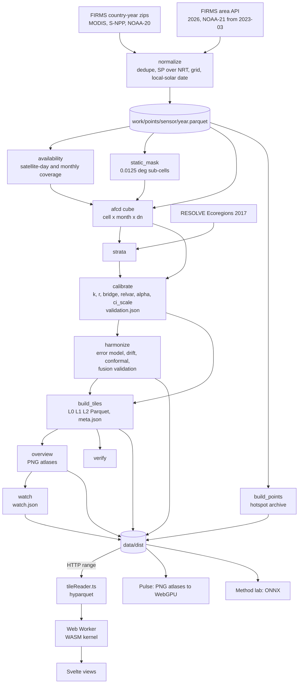

# Architecture

How the repository is laid out, how data gets from FIRMS files to pixels, and what a deployment needs. For the science see [METHOD.md](METHOD.md); for running things see [OPERATIONS.md](OPERATIONS.md). [design.md](design.md) is the original plan; where it differs from this file or from the code, the code is right (differences are listed at the end). [ux/audit.md](ux/audit.md) is the UX audit behind the guided-scroll layout.

## Repository map

```
README.md                  entry point
Cargo.toml                 Rust workspace: crates/harmony-core, crates/harmony-wasm
crates/harmony-core/src/   analysis kernel, pure Rust, no I/O
  geom.rs                  polygon cleaning, spherical area, per-cell coverage weights, tile keys
  store.rs                 columnar store of the tile rows inside the area
  series.rs                monthly zonal sums, per-group fusion with drift correction, conformal bounds, units lens
  stats.rs                 baseline, climatology, calendar, annual, year to date, current, records, seam (complete-enough months only)
  trend.rs  season.rs  outlook.rs  analogs.rs  robust.rs  cells.rs  meta.rs  engine.rs
crates/harmony-wasm/src/   wasm-bindgen wrapper (Kernel class)
pipeline/                  Python 3.13 (uv), DuckDB; harmony_pipeline/*.py, one module per stage
schema/                    data-contract.md, validation.md, ml.md, watch.md (interfaces)
web/                       Vite 8 + Svelte 5 + TypeScript single-page app
  src/App.svelte               the guided scroll: status strip, section index, one component per question
  src/lib/session.svelte.ts    area -> tiles -> kernel -> analysis state machine
  src/lib/data/                tileReader.ts (Parquet over HTTP), tileCache.ts (byte-bounded LRU), watch.ts
  src/lib/kernel/              main-thread client, Web Worker, WASM bindings (pkg/ is generated)
  src/lib/components/          one view per section (calendar, season, trend, outlook, now, brief, how we know, exports),
                               glossary.ts + Term.svelte (in-place explanations), evidence panels (fusion, drift, conformal)
  src/lib/pulse/               Global pulse: four colour modes, WebGPU/canvas globe, watch overlay
  src/lib/sound/               "Listen": pure mapping (testable in Node), Web Audio player
  src/lib/live/  brief/  ml/  export/  map/  brand/
  server/liveCore.ts, livePlugin.ts   /api/live
  server/ai/                          /api/brief, /api/ask
  server/sameOrigin.ts                cross-site guard shared by the three routes
scripts/                   build-wasm.sh and five test scripts (see the README)
docs/                      this file, METHOD.md, OPERATIONS.md, design.md, brand/, ux/, deck/
data/                      git-ignored: raw/ (downloads), work/ (intermediate), dist/ (served)
```

Generated and git-ignored: `data/`, `target/`, `node_modules/`, `web/dist/`, `web/src/lib/kernel/pkg/`, `.env.local`.

## Data flow: FIRMS files to pixels



The `all` stage order is `normalize, availability, static_mask, afcd, strata, calibrate, harmonize, tiles, points, overview, watch, verify` (`cli.py`, `STAGES`). `ml` is run by name.

1. **Normalize** (`normalize.py`) reads each sensor-year from its country zip and from API files, maps columns to one schema, drops duplicates, lets standard-quality rows replace near-real-time rows per satellite and UTC month, computes the sub-cell, the L0 cell, the local-solar date and the month index, and writes `work/points/{sensor}/{year}.parquet`. Per-file statistics go to `work/normalize_stats/`. A row is near-real-time when its `version` contains `NRT`; FIRMS `URT` rows (newest day) are not matched, a known fault described in METHOD.md (Known issues).
2. **Availability, static mask, cube** compute satellite-day availability, the mask, and the cell-day cube (`afcd.py`) one local-solar year at a time to bound memory.
3. **Strata and calibration** assign each fire-active cell a stratum and fit the coefficients (`strata.py`, `calibrate.py`), writing `work/coefficients/` and `dist/validation.json`.
4. **Harmonize** (`harmonize.py`, after `calibrate`) estimates the sensor error model by triple collocation, the MODIS orbit-drift ratios, the conformal multipliers and the validation of the fused record, writes `work/coefficients/harmonize.json` and adds its tables to `dist/validation.json`.
5. **Tiles** (`build_tiles.py`) apply the coefficients to the cube, scale by 100, round to integers at L0 and sum upward, so L1 and L2 are exact sums of L0. `meta.json` carries what the kernel needs: per-stratum error model, `fusion.kappa`, `drift`, `conformal`, and the legacy `relvar`, `alpha`, `ci_scale`.
6. **Points, overview, watch, verify** write the hotspot archive, the global PNG atlases (including fire clock and trend), the watchlist and the reconciliation report. The ML model is a separate stage (`ml`).
7. **Browser.** The tile reader fetches the tiles for an area, the worker's kernel turns rows into the analysis, and Svelte renders it.

## The data contract in brief

Full text: [schema/data-contract.md](../schema/data-contract.md). Everything the app reads is under `data/dist/` and is served at `/data/` (base set by `VITE_DATA_BASE`).

| Path | Content |
| --- | --- |
| `meta.json` | Version, `data_through`, month bounds, levels (with tile sizes), per-month coverage, provisional and VIIRS-satellite masks, 64 strata with the error model (`err`), `relvar`, `alpha`, `relvar_bridge` and `k`, `fusion`, `drift`, `conformal`, `ci_scale` (legacy), method parameters, sources |
| `tiles/index.json` | `{ "L0": { "tx_ty": [bytes, rows] } ... }`; a tile missing from the index has no fire data |
| `tiles/L{0,1,2}/{tx}_{ty}.parquet` | Rows `(cell, stratum, m, dn)` with `meq`, `kv`, `kvsq`, `v`, `nmod`, `nvii`; integers x100; sorted by cell, stratum, month, dn. Tile sizes 2.5, 10 and 30 degrees |
| `points/{px}_{py}/{year}.parquet`, `points/index.json` | Raw accepted and rejected detections in 10-degree tiles, row groups of at most 49,152 rows, sorted by 1-degree block, UTC month, L0 cell and time so that row-group statistics prune by area and date |
| `overview/` | 0.5-degree PNG atlases: one per year for the pulse, climatology, land mask, fire clock (`season.png`), trend (`trend.png`), `meta.json` |
| `watch.json` | The watchlist: unusual clusters for the latest month and the last three months ([schema](../schema/watch.md)) |
| `validation.json` | Calibration, error-model, drift, conformal, fusion and sensor-test results, shown in the app ([schema](../schema/validation.md)) |
| `ml/model.onnx`, `ml/model.json` | ML challenger ([schema](../schema/ml.md)) |

Grid: level `L` has cell size `c`; `cell = floor((lat+90)/c) * NX + floor((lon+180)/c)` with `NX = 360/c`; month index `m = (year-2000)*12 + month-1`, first data month 2000-11 (`m = 10`). Levels are additive.

Table A1 gives the size of the current build.

## Kernel API

The kernel (`harmony-core`) is stateful per area and has no I/O. `harmony-wasm` exposes it as the `Kernel` class; `web/src/lib/kernel/worker.ts` hosts it in a plain module Web Worker (no SharedArrayBuffer, so no COOP/COEP headers are needed) and handles requests strictly in arrival order; `client.ts` is the main-thread side. A trapped WASM instance is detected and the worker is replaced.

| Call | Purpose |
| --- | --- |
| `new Kernel(meta_json)` | Parse `meta.json` (only the fields the kernel needs; a `meta.json` without the harmonization fields falls back to the switch rule and the legacy interval) |
| `set_aoi(flat_coords, ring_offsets)` | Take polygon rings (lon/lat; first ring outer, others holes; even-odd rule); returns area, bbox, centroid |
| `tiles_for(level)` | Tile keys `tx_ty` that hold cells of the area at that level |
| `begin(level)` | Fix the working level, compute per-cell coverage weights, clear the store |
| `ingest_tile(cell, stratum, m, dn, meq, kv, kvsq, v, nmod, nvii)` | Add a tile's columns; keeps rows whose cell is in the area with its weight; returns the count kept |
| `analyze(options_json)` | `{switchM, baseline, dn, range, mode, unit}` (`mode` `fused` by default or `switch`; `unit` `modis` or `viirs`) returns the whole analysis as JSON: series with bands and MODIS weight, calendar, climatology, annual, year to date, current month, trend, season, outlook, seam, records, analogs, harmonization summary |
| `cell_layer(options_json)` | Per-cell values (or ratio to the cell's own baseline) for a month window, for the map overlay; fused per tile row unless `seriesMode: "switch"` |

Coverage weights come from a scanline rasteriser: each cell row is cut by 16 horizontal sub-lines and the inside spans are clipped exactly to the cells, so interior cells weigh exactly 1 and boundary cells are exact horizontally and 16-fold supersampled vertically. Edges are straight lines in longitude and latitude, the space the grid lives in. Output shapes are mirrored in `web/src/lib/kernel/types.ts`. The Method lab, the hotspot export, the sound player and the live pace run in the main thread or their own modules and do not go through the kernel. The Global pulse and the watchlist read the PNG atlases and `watch.json` directly; they are built with the switch rule and without drift correction, so they are not the same computation as the kernel's default series (METHOD.md, section 11).

## Choosing the level for an area

`session.svelte.ts`, `pickLevel`: levels are tried from finest (L0, 0.05 degree) to coarsest (L2, 1 degree). For each, the kernel lists the tiles the area touches and the sizes come from `tiles/index.json`. The first level whose tiles total at most `MAX_AOI_BYTES` (16 MiB, `config.ts`) is used. If none fits, the coarsest level is used anyway; the app does not refuse. Without an index (demo mode) the cell count is capped at 60,000 instead. Tiles are fetched four at a time, decoded by hyparquet into typed arrays and passed to the kernel in order. Decoded tiles are kept in a byte-bounded least-recently-used cache (`tileCache.ts`, 256 MiB): tiles still in flight or used by the run in progress are never evicted, even when they alone exceed the budget, and a failed read is dropped so that the next request retries it. A change of options (baseline, record mode, units, day or night, range) re-runs only `analyze`; a new area re-runs the whole chain, and a newer request aborts an older one.

Parquet reading (`tileReader.ts`): files up to 2 MiB are fetched whole in one request; larger files use HTTP range requests through hyparquet (footer, then column chunks). All ten columns are read, so range requests save bytes only by skipping row groups that are not needed.

## Server routes and their security model

Three routes exist because they need secrets. In development they are Vite plugins (`vite dev` and `vite preview`); their cores are written without Vite, Node HTTP or Svelte imports so that a serverless handler can call them with the environment passed in.

| Route | Purpose | Core |
| --- | --- | --- |
| `GET /api/live?bbox=w,s,e,n&days=N`, `GET /api/live/status` | FIRMS near-real-time proxy: NOAA-20, NOAA-21 and MODIS near-real-time rows for a box, as columnar JSON | `web/server/liveCore.ts` `getLive`, `liveStatus` |
| `GET /api/brief` (status), `POST /api/brief` | Structured situation brief for an area, streamed as NDJSON | `web/server/ai/core.ts` `getBrief`, `getStatus` |
| `POST /api/ask` | Follow-up questions on the same area, streamed | `getAnswer` |

**Keys stay on the server.** `FIRMS_MAP_KEY`, `ANTHROPIC_API_KEY` and `OPENROUTER_API_KEY` are read on each request from `.env.local`, then `.env`, then the process environment, and only the variables a route needs are picked out. They are passed to the upstream call and nowhere else. Upstream-derived strings go through a redaction step that removes the key and any key-shaped URL segment before they are logged or returned; the unit tests check that a key never appears in a response. The AI adapter constructs the SDK client with the key and does not store it.

**Origin checks.** All three routes, including the status calls, first apply `sameOrigin.ts`: a request is refused with 403 when the browser says it is cross-site (`Sec-Fetch-Site: cross-site`) or carries an `Origin` header (including the opaque `null`) that is not the server's own host. Requests without these headers (curl, server-to-server, the smoke scripts) pass. The aim is that another website cannot make a visitor's browser spend the server's FIRMS or model quota. The AI routes also require `Content-Type: application/json`, which forces a preflight that is never approved.

**Validation.**
- Live: unknown parameters, malformed numbers, boxes outside the world or crossing the antimeridian, and more than 7 days are rejected with 400. The box is snapped outward to 0.5 degrees and refused above 900 square degrees after snapping.
- AI: size is capped (the dossier at 16 KiB; Ask adds at most 8 turns of 500-character questions). The dossier is rebuilt field by field in a fixed key order from a known shape; unknown keys, non-finite numbers and out-of-range values are rejected; the area label is reduced to a name-like character set of at most 80 characters because it enters the prompt. The prompt tells the model to treat the label and the questions as data.
- Output: the brief is validated for structure and length and every figure in it must match a number in the dossier (within rounding; signed figures keep their sign against words such as rising and falling; small ordinals and counts in recognised patterns are allowed); one corrective retry, then the rule-based brief is used. Ask answers stream and cannot be retracted, so ungrounded figures come back as a warning. The check catches invented or mis-scaled figures; it is not a proof of correctness.
- Truncated streams: a provider stream that ends without a stop reason, a refusal, a `max_tokens` stop or an OpenRouter `finish_reason` of `length` or `error` is never served or cached as an answer. A cut stream is retried once, then goes to the fallback provider if one is configured, else the route answers 502 `upstream_error`; no half answer reaches the page.

**Rate limits and caches** (per server process, in memory):

| | Live | Brief | Ask |
| --- | --- | --- | --- |
| Request limit | 12 upstream batches per minute (cache hits are free) | 10 per minute | 20 per minute |
| Cache | 48 boxes, 10 minutes (2 minutes if a source failed); expired entries kept up to 6 hours as a fallback | 200 responses, 1 hour | same cache |
| Other protection | Shares one upstream job between concurrent identical requests; checks the key's transaction usage and answers 503 `busy` above 90 % of the 10-minute budget | Retry once on transient errors, then optional fallback provider; no retry on 4xx or refusals | same |

The limits are global to a process, not per client, so one heavy client can use up the shared allowance for everyone; and because they are per instance, a serverless deployment multiplies them. A shared store would fix both (below).

## Performance

Numbers that exist in the repository's own test outputs, measured on the development machine (Windows 11, Node 26.12 for the script, Rust 1.100 for the tests) on 2026-11-15. They are timings on synthetic data and do not include network or Parquet decoding.

| Measure | Value | Source |
| --- | --- | --- |
| Kernel unit tests | 44 pass in 0.74 s (debug build) | `cargo test -p harmony-core` |
| Analysis of a small area (300 cells, 2025 record), WASM in Node | 5.4 ms, 32 KB of JSON | `scripts/kernel-smoke.mjs` |
| Large area: rasterise and list tiles | 7.4 ms for 167 tiles | same |
| Large area: ingest 2,114,000 rows | 44 ms | same |
| Large area: analysis of those rows | 13.6 ms | same |
| WASM binary | 351,027 bytes | `web/src/lib/kernel/pkg/` |
| Test guards | rasterising a 4,000-vertex polygon of about 40 x 35 degrees at 0.05 degrees, and analysing 2.1 million rows, each have a timing assertion | `geom.rs`, `engine.rs` tests |

Page weight is dominated by lazily loaded ONNX Runtime assets (two WASM files of 14.8 and 28.7 MB, fetched only when the Method lab opens); the main script is 1.84 MB (`web/dist/assets`), and the Global pulse and the below-the-fold sections are loaded lazily. Tile sizes are in Table A1.

## Table A1. Data build size (as of the 2026-11-15 build)

Update from `data/dist/tiles/index.json`, `points/index.json`, `meta.json` and file sizes after a refresh.

| Item | Value |
| --- | --- |
| L0 (0.05 degree, 2.5-degree tiles) | 3,873 tiles, 417.2 MB, 75,075,454 rows; largest tile 1.91 MB |
| L1 (0.25 degree, 10-degree tiles) | 435 tiles, 128.4 MB, 17,224,525 rows; largest tile 3.56 MB |
| L2 (1 degree, 30-degree tiles) | 70 tiles, 33.7 MB, 3,945,900 rows; largest tile 3.11 MB |
| Tiles in all | 579.4 MB |
| Hotspot archive | 489 tile directories, 8,289 files, 11.34 GB, 656,491,914 rows |
| Overview | 7.1 MB (27 yearly atlases, climatology, land mask, fire clock, trend, `meta.json`) |
| ML model | 33,408 bytes ONNX, 41,991 bytes of JSON |
| `meta.json`, `validation.json`, `watch.json` | 112 KB, 527 KB, 39 KB |
| Normalized rows | 656,491,914 (114,530,845 MODIS; 296,606,261 S-NPP; 172,221,067 NOAA-20; 73,133,741 NOAA-21) |
| Strata | 64 |

## What a production deployment needs

Nothing about the analysis needs a server. A deployment is:

1. **Static hosting for `web/dist`** (output of `pnpm --dir web build`).
2. **Object storage or a static host for `data/dist`** that supports HTTP `Range` requests and `Accept-Ranges`, serves `.parquet` with a binary content type and `.json` as JSON, and sends `Access-Control-Allow-Origin` if it is on another origin. Set `VITE_DATA_BASE` at build time to its URL. Tiles are immutable per release, so long cache lifetimes with a versioned path are safe; `meta.json`, `watch.json` and the indexes should not be cached long.
3. **Up to three serverless functions** wrapping `getLive`/`liveStatus`, `getBrief`/`getStatus` and `getAnswer`, with the keys in the platform's secret store and the same-origin check (`sameOrigin.ts`) applied to the request headers. They must be reachable at the same origin as the app: the live client uses the fixed path `/api/live`, and the AI client uses `/api/brief` and `/api/ask` unless `VITE_BRIEF_API` and `VITE_ASK_API` are set (`VITE_BRIEF_API=off` skips the probe for a site without AI). Without them the app still works; the live view and the AI features report themselves as unavailable.
4. **A shared cache and rate limiter** (a key-value store or the platform's edge rate limiting) in place of the in-memory maps, with per-client limits.

No COOP/COEP headers are needed. The data is rebuilt offline ([OPERATIONS.md](OPERATIONS.md)) and published as a new release of `data/dist`.

## Differences from design.md

- NOAA-21 enters from 2023-03 (standard-quality, via the API), not 2024-01-17; near-real-time NOAA-21 starts 2024-01-17.
- Strata are biome x realm only; the MCD12C1 cropland flag was not implemented.
- The per-AOI byte budget is 16 MiB, not 8 MB; L2 is stored as 30-degree tiles (builds before the 2026-11-15 refresh held it as one 360-degree tile; the reader takes tile size from `meta.json`).
- The calibration is a ratio of sums (the quasi-Poisson maximum-likelihood estimate), not a statsmodels negative-binomial fit; `statsmodels`, `scipy`, `pyarrow`, `httpx` and `python-dotenv` are declared in `pyproject.toml` but not imported by the pipeline code.
- There is no `harmony update` command and no `schema/tile-schema.json`; the top-up is `fetch-api` then `all`, and the schema is `schema/data-contract.md`.
- The default record is a per-stratum, per-overpass fusion with drift correction and conformal intervals, not a hard switch at 2023-01; the switch is an option. The pipeline gained the `harmonize` and `watch` stages.
- The product is one guided scroll ordered by questions, with a glossary, a Global pulse with four modes, a watchlist, sonification, an uncertainty-aware calendar mode, a live proxy with a Now card, an AI brief and Ask Harmony (Anthropic primary, OpenRouter adapter), an in-browser ONNX challenger and exports with a range choice; none of this was in the plan.
- The overview atlases, the trend map and the watchlist are built from the L1 tiles with `meq` before the switch month and `kv` from it, in Python, without drift correction and without fusion; the kernel fuses by default and falls back to MODIS when VIIRS has no coverage. The two agree wherever one stream alone is served; they can differ where the kernel blends, most from 2020 on.
